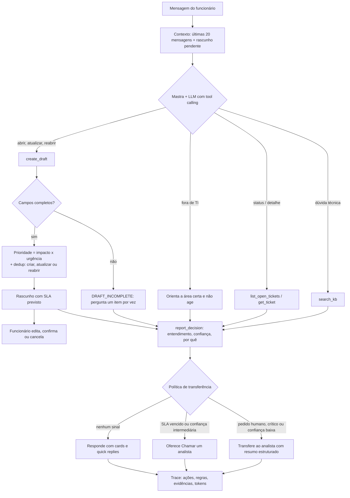

# Nexo Assist

Agent de service desk de TI para o desafio técnico **Beyond the Bytes**. Baseline de produto: [docs/desafio/Desafio_Tecnico_Nexo_Assist_PRD_v5.pdf](docs/desafio/Desafio_Tecnico_Nexo_Assist_PRD_v5.pdf). Lacunas documentadas: [docs/desafio/GAPS.md](docs/desafio/GAPS.md).

**Versão da aplicação:** `0.8.0-m8.3` (M8.3: UI de rascunho, console do analista e entrega PRD) — ver [CHANGELOG.md](CHANGELOG.md).

**Sumário da entrega:** [Como o agent decide](#como-o-agent-decide) · [Garantia da qualidade](#garantia-da-qualidade) · [Escolha do modelo](#escolha-do-modelo) · [Decisões e trade-offs](#decisões-e-trade-offs) · [O que faria com mais tempo](#o-que-faria-com-mais-tempo) · [Custo por conversa](#custo-por-conversa)

## Documentação

| Onde | Conteúdo |
|------|----------|
| [docs/README.md](docs/README.md) | Especificação (pacote docs **0.3.6**) |
| [docs/desafio/](docs/desafio/README.md) | PRD, protótipo, GAPS |
| [docs/desenvolvimento/](docs/desenvolvimento/README.md) | Status M1–M5, arquitetura |
| [docs/execucao/](docs/execucao/README.md) | Guias F1–F5 |

## Início rápido

```bash
cp .env.example .env
docker compose up -d db
npx prisma migrate deploy
npx prisma db seed
npm run dev
```

Login: [http://localhost:3000/login](http://localhost:3000/login) — funcionário `ana.souza@nexo.com.br` → `/atendimento`; analista `rafael.lima@nexo.com.br` → `/atendente/conversas` (qualquer senha no seed).

## Stack

Next.js 15, Prisma, PostgreSQL, iron-session, agent em `lib/agent/` (OpenRouter-ready), SSE chat.

## Testes

Pré-requisito para E2E: banco migrado e seed (`npx prisma migrate deploy` e `npx prisma db seed`).

```bash
npm run prepare:e2e   # 1ª vez: baixa Chromium (senão E2E falha)
npm run test:e2e      # sobe `next dev` em 127.0.0.1:3099 (não reutiliza :3000)
npm run test          # Vitest + Playwright
npm run test:unit     # Vitest completo
npm run test:evals    # EVAL-01..15 + variações de frase (determinístico, fixtures)
npm run test:evals:llm # opcional: mesma matriz com o modelo real (exige OPENROUTER_API_KEY; fora do CI)
npm run build
```

Dev manual (`npm run dev`) usa **http://localhost:3000**. Os E2E sobem um servidor dedicado em **127.0.0.1:3099** por padrão.

| Variável (opcional) | Default | Uso |
|---------------------|---------|-----|
| `PLAYWRIGHT_PORT` | `3099` | Porta do `webServer` do Playwright |
| `PLAYWRIGHT_BASE_URL` | `http://127.0.0.1:3099` | `baseURL` dos testes |
| `PLAYWRIGHT_REUSE_SERVER` | ausente | Defina `1` para reutilizar servidor já no ar (exige `PLAYWRIGHT_BASE_URL` coerente) |

### OpenRouter (dev com LLM real)

Em `.env`:

```env
OPENROUTER_API_KEY=sk-...
OPENROUTER_MODEL=openai/gpt-4o-mini
# opcional — default https://openrouter.ai/api/v1
OPENROUTER_BASE_URL=https://openrouter.ai/api/v1
AGENT_EVAL_FIXTURES=false
LLM_MAX_CONCURRENCY=2
```

O agent roda em **Mastra** com tool calling; use um modelo com suporte a tools (recomendado `openai/gpt-4o-mini`). Se o LLM falhar (HTTP, timeout ou modelo sem tools), o chat responde "assistente indisponível" e o erro fica no trace — não há fallback silencioso para fixtures. As **fixtures** só rodam com `AGENT_EVAL_FIXTURES=true` (CI/evals).

Ajustes opcionais: `AGENT_HISTORY_MAX_MESSAGES` (20), `AGENT_MAX_STEPS` (5), `AGENT_MAX_OUTPUT_TOKENS` (1024), `AGENT_LLM_TIMEOUT_MS` (45000).

### Perfis de ambiente (G-PRD-02)

| Perfil | Quando | `AGENT_EVAL_FIXTURES` | LLM |
|--------|--------|------------------------|-----|
| **Local dev** | `npm run dev` | `true` (default no `.env.example`) ou `false` com OpenRouter | Opcional |
| **CI / E2E** | GHA jobs `test` + `e2e`, Playwright local | `true` (obrigatório) | Desligado |
| **Demo LLM** | Entrevista / staging | `false` + `OPENROUTER_API_KEY` | OpenRouter |

Detalhes: [`.env.example`](.env.example), [02-09](docs/02-especificacao/02-09-variaveis-ambiente.md).

### Gates de validação (G-OPS-02)

| Onde | Unit + evals | E2E | `next build` |
|------|--------------|-----|--------------|
| Local pré-push | `npm run test:unit` + `npm run test:evals` | `npm run test:e2e` | `npm run build` |
| GitHub Actions | job `test` | job `e2e` | job `test` (+ Docker em `build`) |

### Chat SSE

1. Abrir `EventSource` em `GET /api/conversations/:id/stream?turnId=<uuid>`.
2. Aguardar conexão (`open`).
3. `POST /api/conversations/active/messages` com o mesmo `turnId`.

## APIs principais

| Rota | Descrição |
|------|-----------|
| `GET /api/conversations/active` | Sessão ativa (`state`, contador /30) |
| `POST /api/conversations/active/messages` | Enviar mensagem (202; 429 limite; 423 analista) |
| `GET /api/conversations/:id/stream` | SSE do turno |
| `POST /api/conversations/active/new-session` | Nova sessão |
| `PATCH /api/tickets/drafts/:draftId` | Edita campos de um rascunho pendente (próprio funcionário) |
| `POST /api/tickets/drafts/:draftId/confirm` \| `cancel` | Rascunho → ticket |
| `GET /api/analyst/inbox` | Fila analista (ETag / 304) |
| `POST /api/analyst/conversations/:id/assume` \| `return-to-agent` \| `close` | Handoff |
| `POST /api/analyst/conversations/:id/messages` | Mensagem do analista |

### Fluxo draft (M4)

1. Agent propõe rascunho no chat: o card mostra os seis campos em PT-BR (tipo, categoria, título, descrição, prioridade, afetados) e o SLA previsto.
2. **Editar** abre o card em modo de edição e salva via `PATCH` (validação com Zod; a prioridade/SLA são recalculados no servidor). Só o dono edita, e só enquanto o rascunho está pendente.
3. **Confirmar** / **Cancelar** chamam as rotas acima.
4. `TICKET_CHAOS_RATE=1` força 503 no ticket-service (demo `E2E-CHAOS`).

### Transfer e limite

- `transfer_to_analyst` → `state=awaiting_analyst`, composer desabilitado.
- 30 mensagens **do funcionário** por sessão (respostas do assistente não contam) → modal + **Nova sessão**.

## Marco atual

| Marco | Estado |
|-------|--------|
| M1–M7.1 | Concluídos — [status](docs/desenvolvimento/status-implementacao.md) |
| M8.1–M8.3 | Concluídos — regras de negócio e transferência com resumo (M8.2), UI de rascunho, fila de revisão e entrega (M8.3); [GAPS2](docs/desafio/GAPS2.md) |

## Como o agent decide

Cada mensagem do funcionário vira **um turno** (`lib/agent/`, sem acesso direto ao banco). O modelo escolhe ferramentas; tudo que muda estado passa por regras determinísticas e pelo `ticket-service`.



- **O modelo decide o que fazer; o código decide o que é permitido.** O modelo nunca cria chamado direto: só propõe rascunho. A prioridade vem de `classifyPriority` (impacto × urgência), não do texto do modelo.
- **Escopo:** RH, financeiro e facilities são recusados com a área correta (`OUT_OF_SCOPE`).
- **Privacidade:** chamado de outro usuário e chamado inexistente recebem a mesma resposta ("não encontrei").
- **Transferência (`lib/agent/transfer-policy.ts`):** pedido explícito, prioridade crítica ou confiança abaixo de `AGENT_CONFIDENCE_TRANSFER_STRONG` (35) transferem; SLA vencido ou confiança abaixo de `AGENT_CONFIDENCE_TRANSFER_OFFER` (50) apenas **oferecem** "Chamar um analista". O analista recebe problema, passos tentados, chamados e motivo.
- **Transparência:** cada resposta guarda entendimento, ações, regras disparadas (com rótulos em PT), evidências, "por quê" e consumo de tokens/latência — visível no chat e no console.

## Garantia da qualidade

| Camada | O que cobre | Comando |
|--------|-------------|---------|
| Unitários | Regras puras: prioridade, SLA, dedup, política de transferência, schemas | `npm run test:unit` |
| Integração (Postgres) | `ticket-service` (incl. edição de rascunho), fila do analista, persistência | `npm run test:unit` |
| Evals EVAL-01..15 | Cenários do PRD de ponta a ponta no agent | `npm run test:evals` |
| Evals de variação (G2-QA-01) | Cada intenção (KB, status, abrir, crítico, atualizar, transferir, escopo, privacidade) com 3–5 formulações; valida **ações, regras e blocos**, nunca o texto | `npm run test:evals` |
| Evals com LLM (opcional) | A mesma matriz com o modelo real e relatório de acurácia por intenção | `npm run test:evals:llm` |
| E2E (Playwright, 15 specs) | Login, chat, rascunho editável, transferência, console do analista, caos | `npm run test:e2e` |

Os evals determinísticos usam fixtures (`AGENT_EVAL_FIXTURES=true`) e rodam no CI sem custo. O eval com LLM é opcional: mede o comportamento real do modelo contra um piso de acurácia (`EVAL_LLM_MIN_ACCURACY`, padrão 0,7). Última medição com `openai/gpt-4o-mini` (35 frases): **77%** — KB, status, atualização, transferência e privacidade em 100%; o ponto fraco é "fora do escopo", em que o modelo recusa mas nem sempre marca `outOfScope` (ver [O que faria com mais tempo](#o-que-faria-com-mais-tempo)).

## Escolha do modelo

**`openai/gpt-4o-mini` via OpenRouter**, com o Mastra:

- Suporta **tool calling** de forma confiável (modelos gratuitos, em geral, não suportam e quebram o fluxo).
- Custo e latência baixos para um assistente de conversa curta (ver [Custo por conversa](#custo-por-conversa)).
- Trocar de modelo é só `OPENROUTER_MODEL`; a matriz `test:evals:llm` mostra a regressão de comportamento antes de adotar outro.
## Decisões e trade-offs

| Tema | Decisão | Motivo |
|------|---------|--------|
| Agent runtime | Mastra (`@mastra/core`) em `lib/agent/mastra/` com tool calling sobre `lib/agent/tools.ts`; fixture só em CI | Decisão por entendimento do modelo, com histórico e rascunho pendente; evals/E2E determinísticos |
| LLM default | `AGENT_EVAL_FIXTURES=true` sem API key | CI e onboarding sem custo |
| E2E | Porta **3099** dedicada | Evita colisão com `next dev` :3000 |
| Mutação tickets | Sempre via draft confirmado | Único writer `ticket-service`; dedup Anexo A |
| Handoff | Employee bloqueado em `awaiting_analyst` e `with_analyst` (423) | CR [04-02 §0.3.3](docs/04-registro-mudanca/04-02-registro-mudancas.md); gap **G-UI-E08** `aceito` |
| Rate limit | In-memory por IP em `/api/*` | Doc PRD; produção atrás de proxy real |
| UI | Tailwind + componentes próprios | Inspiração TailAdmin, não fork do kit |
| Deploy | Compose + runbook VPS; CI = test → e2e → docker → SSH deploy | [deploy-vps.md](docs/desenvolvimento/deploy-vps.md) |

Trade-offs adicionais assumidos na entrega:

| Tema | Decisão | Custo da escolha |
|------|---------|------------------|
| Edição de rascunho | `PATCH` direto nos seis campos, inclusive prioridade | O rascunho guardado não tem impacto/urgência; a prioridade editada vale como está e o SLA é recalculado a partir dela |
| Fila do analista | Conversas ainda com o agent entram como "Revisão sugerida" quando a confiança do último turno é baixa | O analista só **vê**; assumir continua exigindo transferência (handoff explícito) |
| Evals | Matriz determinística no CI + execução com LLM sob demanda | O CI não detecta regressão de comportamento do modelo real |
| Quick replies | Derivadas dos dados reais (chamado vencido, seletor); "Chamar um analista" vem da política | Menos atalhos fixos de FAQ no chat |
| Deploy público | Adiado (`G2-QA-05`) | O avaliador roda localmente com `docker compose` ou no runbook de VPS |

## O que faria com mais tempo

1. **Fora de escopo no caminho LLM:** combinar o classificador determinístico (`classifyOutOfScope`) com a decisão do modelo, para que `OUT_OF_SCOPE` seja sempre registrado (hoje só quando o modelo marca `outOfScope`).
2. **Evals com LLM no CI noturno**, com orçamento fixo e série histórica de acurácia por intenção.
3. **Impacto e urgência no rascunho:** guardar os dois campos e permitir editá-los no card, em vez de editar a prioridade diretamente.
4. **Assunção direta de "Revisão sugerida":** permitir que o analista assuma uma conversa com baixa confiança sem esperar a transferência.
5. **Streaming de tokens** no chat e **resumo da conversa** para sessões longas, reduzindo tokens de entrada.
6. **Observabilidade:** métricas (latência, tokens, taxa de transferência) em um painel e alertas de custo.
7. **Deploy público** com TLS e dados de demonstração isolados (`G2-QA-05`).

## Custo por conversa

Medido com `npm run test:evals:llm` (`openai/gpt-4o-mini`, 35 turnos, 2026-11-25), lendo `trace.usage`:

| Métrica | Média por turno |
|---------|-----------------|
| Tokens de entrada | ≈ 9.600 |
| Tokens de saída | ≈ 230 |
| Latência | ≈ 5,9 s |

Fórmula: `custo = turnos × (tokens_entrada × preço_entrada + tokens_saída × preço_saída)`. Com os preços de referência do modelo no OpenRouter (US$ 0,15 / 1 M tokens de entrada e US$ 0,60 / 1 M de saída — confirme na tabela atual), cada turno custa ≈ **US$ 0,0016**.

| Cenário | Turnos | Custo estimado |
|---------|--------|----------------|
| Conversa curta típica | 8–10 | ≈ US$ 0,013–0,016 |
| Sessão completa (limite do PRD) | 30 | ≈ US$ 0,05 |

Ressalvas: a medição foi feita com o banco de desenvolvimento cheio de chamados de teste, o que **infla os tokens de entrada** (a ferramenta de listagem devolve todos os chamados abertos); com o seed limpo o consumo tende a ser menor. O histórico enviado ao modelo é limitado a 20 mensagens (`AGENT_HISTORY_MAX_MESSAGES`), o que mantém o crescimento por turno sob controle.
## Estrutura

```
lib/agent/              # Agent (sem Prisma)
src/lib/analyst/        # Console analista
src/lib/conversation/
src/lib/ticket-service/
tests/evals/            # EVAL-01..15 + matriz de variações (intent-variations) + LLM opcional
e2e/                    # 15 specs Playwright
```