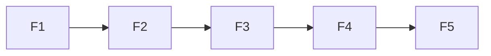

# EAP / WBS — Estrutura analítica do projeto

## Nível 1

**1.0 Nexo Assist** — Agent de service desk TI (desafio Beyond the Bytes + portfólio)

## Nível 2 — Fases compiláveis

| ID | Fase | Objetivo entrega |
|----|------|------------------|
| 1.1 | F1 Fundação | Auth, layout, persistência base, Compose |
| 1.2 | F2 Tickets + KB | Serviço simulado, FTS, chaos 503, SLA clock |
| 1.3 | F3 Agent leitura | Mastra, SSE, trace, evals ~5 |
| 1.4 | F4 Mutações | Draft, Anexo A, transfer, 30-msg, evals expandem |
| 1.5 | F5 Analista + hardening | Console, handoff, E2E, GHA deploy |

## Nível 3 — Pacotes de trabalho

### F1 — Fundação (1.1.x)

| WBS | Entregável |
|-----|------------|
| 1.1.1 | Repositório Next.js TS strict + Docker Compose + Postgres |
| 1.1.2 | Prisma schema: User, Session, Conversation, Message |
| 1.1.3 | Login/logout + middleware RBAC |
| 1.1.4 | UI login split + layout employee (TailAdmin) |
| 1.1.5 | Tela perfil + seed users mínimo |
| 1.1.6 | README parcial (como subir F1) |

**Critério compilável F1:** `docker compose up` → login Ana → perfil → logout.

### F2 — Tickets + KB (1.2.x)

| WBS | Entregável |
|-----|------------|
| 1.2.1 | Módulo `ticket-service` + client interface |
| 1.2.2 | CRUD/read tickets + drafts API |
| 1.2.3 | KnowledgeArticle + FTS search API |
| 1.2.4 | Seed Anexo B + elenco protótipo |
| 1.2.5 | Chaos rate ENV + 503 + retry client |
| 1.2.6 | `BusinessHoursClock` + testes unitários SLA |
| 1.2.7 | Teste fronteira: agent não importa prisma tickets |

**Critério compilável F2:** APIs tickets/KB via HTTP; chaos testável; seeds visíveis (não exige agent).

### F3 — Agent leitura (1.3.x)

| WBS | Entregável |
|-----|------------|
| 1.3.1 | Mastra agent + OpenRouter |
| 1.3.2 | Tools: list/get ticket, search_kb (via clients) |
| 1.3.3 | SSE route + UI chat employee |
| 1.3.4 | AgentTrace persistido + chips + expand |
| 1.3.5 | Cards seletor e detalhe (sem create INC) |
| 1.3.6 | Evals ~5 cenários CI |
| 1.3.7 | E2E consulta status |

**Critério compilável F3:** Conversa consulta INC-20311 com trace; sem confirmação de chamado novo.

### F4 — Mutações (1.4.x)

| WBS | Entregável |
|-----|------------|
| 1.4.1 | Draft create/confirm/cancel |
| 1.4.2 | Dedup flow + update ticket |
| 1.4.3 | Prioridade + affected quick replies |
| 1.4.4 | Transferência + estado awaiting_analyst |
| 1.4.5 | Limite 30 msgs + nova sessão |
| 1.4.6 | Fora de escopo + rules engine |
| 1.4.7 | Evals adicionais (total interim ~10) |
| 1.4.8 | E2E abrir chamado VPN + transferir |

**Critério compilável F4:** Abrir INC via chat; transferir; conversa persistida aguardando analista.

### F5 — Analista + hardening (1.5.x)

| WBS | Entregável |
|-----|------------|
| 1.5.1 | UI console 3 colunas + filtros |
| 1.5.2 | Polling inbox/thread + POST handoff |
| 1.5.3 | Assume / return / close + 409 |
| 1.5.4 | Trace completo analista |
| 1.5.5 | Seed conversas awaiting_analyst |
| 1.5.6 | Evals total ~15 |
| 1.5.7 | Playwright suite completa |
| 1.5.8 | GitHub Actions: test → image → deploy SSH |
| 1.5.9 | README final + .env.example |

**Critério compilável F5:** Rafael assume Ana; devolve; evals verdes; deploy doc.

## Dependências entre fases

F3 depende de ticket **read** (F2); F4 de F3 (agent base); F5 de F4 (estado transfer).