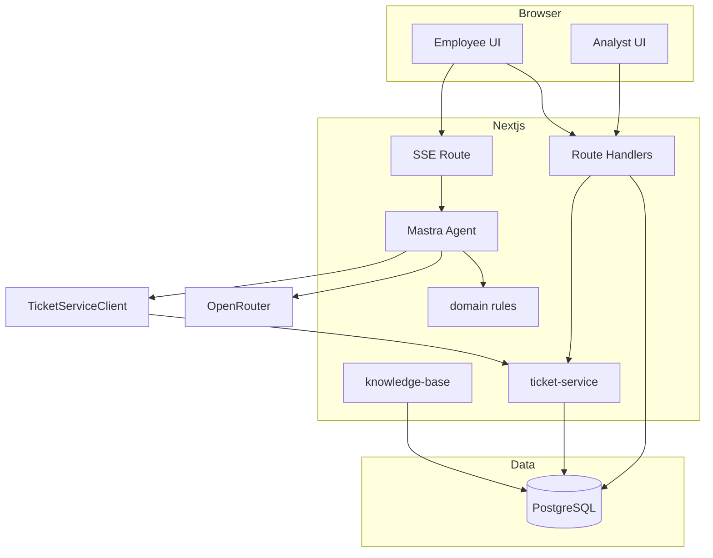
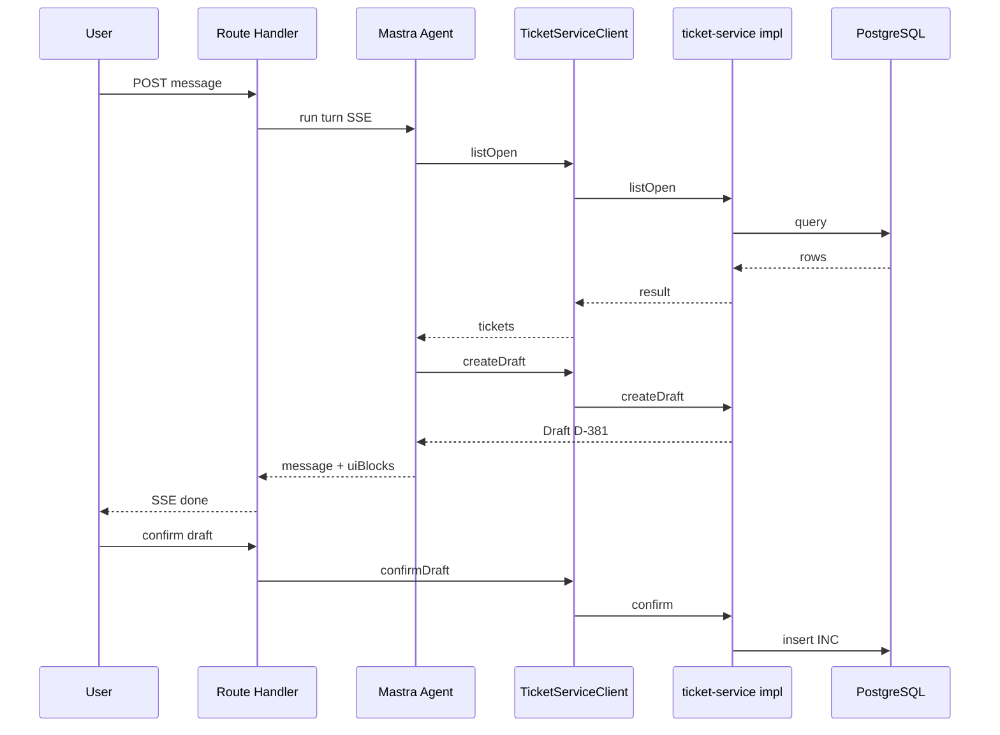

# Especificação técnica

## Stack

| Camada | Tecnologia |
|--------|------------|
| UI | Next.js App Router, TailAdmin OSS, Tailwind |
| API | Route Handlers Next.js |
| ORM | Prisma |
| DB | PostgreSQL 16 |
| Agent | Mastra (plano B: LangGraph.js) |
| LLM | OpenRouter (`OPENROUTER_MODEL`) |
| Runtime local | Docker Compose |
| CI/CD | GitHub Actions → image → SSH VPS |

TypeScript **strict** em todo o repositório.

## Estrutura de pastas (alvo)

```
app/
  (auth)/login/
  (employee)/atendimento/
  (employee)/perfil/
  (analyst)/atendente/conversas/
  api/...
lib/
  agent/           # Mastra, tools, prompts
  ticket-service/  # único writer de tickets
  knowledge-base/  # FTS, seed
  conversation/    # mensagens, sessão, estados
  domain/          # sla.ts, rules.ts, clock.ts
  db/              # prisma client singleton
```

## Arquitetura



## Fronteira do ticket-service

### Princípio

Monólito em **um processo**; isolamento por **módulo e contrato**, não por container separado no MVP.

### Responsabilidades de `lib/ticket-service/`

- Único módulo que persiste `Ticket` e `TicketDraft` via Prisma.
- Aplica privacidade (`requesterId`), validações Anexo A em mutações.
- Simula legado: falha aleatória `TICKET_CHAOS_RATE` (default **0.03**) → HTTP 503 com `retryAfterMs`.
- Gera IDs INC/REQ no `confirm_draft`.
- Calcula `dueAt` via `BusinessHoursClock`.

### Contrato público

```typescript
// lib/ticket-service/client.ts (conceitual)
export interface TicketServiceClient {
  listOpen(requesterId: string): Promise<TicketSummary[]>;
  listRecentResolved(requesterId: string, withinDays?: number): Promise<TicketSummary[]>;
  getById(requesterId: string, ticketId: string): Promise<TicketDetail>;
  createDraft(requesterId: string, input: DraftInput): Promise<Draft>;
  confirmDraft(requesterId: string, draftId: string): Promise<TicketDetail>;
  cancelDraft(requesterId: string, draftId: string): Promise<void>;
  updateTicket(requesterId: string, ticketId: string, patch: TicketPatch): Promise<TicketDetail>;
  reopenTicket(requesterId: string, ticketId: string, reason?: string): Promise<TicketDetail>;
}
```

Implementação interna: `TicketServiceImpl` em `lib/ticket-service/impl/`.

### Fronteira `lib/agent` (orquestração pura)

- **`lib/agent/**` não importa `@/lib/db` nem Prisma** — nem para `Ticket`, nem para `Message`, `Conversation` ou `AgentTrace`.
- O agent (Mastra) **executa tools** e devolve resultado estruturado: texto, `AgentTrace`, `uiBlocks`, intenções de transferência/mutação.
- **Persistência** de mensagens, traces, contadores de sessão e estados de conversa: apenas em **`lib/conversation`** (ou route handler que o invoca), chamado **depois** do turno do agent.
- `transfer_conversation` como tool retorna decisão; a rota aplica `conversation.setState(...)` — o agent não grava fila.

**Teste de fronteira:** teste estático ou integração que falha se qualquer arquivo em `lib/agent/**` importar `@/lib/db` ou `@prisma/client`.

### Anti-padrões proibidos

| Proibido | Motivo |
|----------|--------|
| Prisma em `lib/agent/**` | Mistura orquestração com persistência |
| `import { prisma }` em tools para tickets | Bypassa ticket-service |
| Tool que executa SQL/Prisma direto | Quebra fronteira PRD |
| Route handler que muta ticket sem ticket-service | Inconsistência |

### Tools Mastra (catálogo)

Correspondência 1:1 com métodos do `TicketServiceClient`, regras em [02-08](02-08-regras-service-desk.md#duplicidade-e-reabertura) e módulos auxiliares.

| Tool | Delegação |
|------|-----------|
| `list_open_tickets` | `client.listOpen` |
| `list_recent_resolved` | `client.listRecentResolved` (default `withinDays`: 7) |
| `get_ticket` | `client.getById` |
| `create_draft` | `client.createDraft` |
| `confirm_draft` | `client.confirmDraft` |
| `cancel_draft` | `client.cancelDraft` |
| `update_ticket` | `client.updateTicket` |
| `reopen_ticket` | `client.reopenTicket` |
| `search_kb` | `knowledge-base` (sem ticket DB) |
| `transfer_conversation` | `lib/conversation` (intenção; rota persiste estado) |

### Sequência: abrir chamado



### Evolução

Extrair `ticket-service` para container: trocar `TicketServiceClient` por adapter HTTP mantendo mesma interface e assinaturas das tools.

## Mastra

- Agente único `nexoAssistAgent` com system prompt PT-BR + injeção de regras resumidas.
- Saída estruturada por turno: texto + `trace` JSON.
- Plano B LangGraph documentado no README se Mastra bloquear timeline.

## Domínio

- `lib/domain/sla.ts` — cálculo `dueAt`, `isBreached`.
- `lib/domain/clock.ts` — `BusinessHoursClock`; `TEST_USE_WALL_CLOCK=true` usa relógio injetável fixo nos testes.
- `lib/domain/rules.ts` — `evaluateTransferTriggers`, `isOutOfScope`.

## Autenticação

- Sessão em cookie httpOnly (ex.: `iron-session` ou cookie assinado).
- Middleware Next protege `(employee)` e `(analyst)`.

## Docker Compose

```yaml
# conceitual
services:
  app:
    build: .
    ports: ["3000:3000"]
    env_file: .env
    depends_on: [db]
  db:
    image: postgres:16
    volumes: [pgdata:/var/lib/postgresql/data]
```

Rede interna; Postgres não exposto em produção na VPS salvo admin.

## Variáveis de ambiente

Catálogo completo, defaults e bloco `.env.example`: **[02-09-variaveis-ambiente.md](02-09-variaveis-ambiente.md)**.

Limiares `AGENT_CONFIDENCE_*` usam escala **0–100** (inteiro), igual a `AgentTrace.confidence`.

## Concorrência LLM na VPS

- Fila com `LLM_MAX_CONCURRENCY` (default **2**).
- Rate limit no proxy: `PROXY_API_RATE_LIMIT_PER_MIN` (default **60**) para `/api/*`.