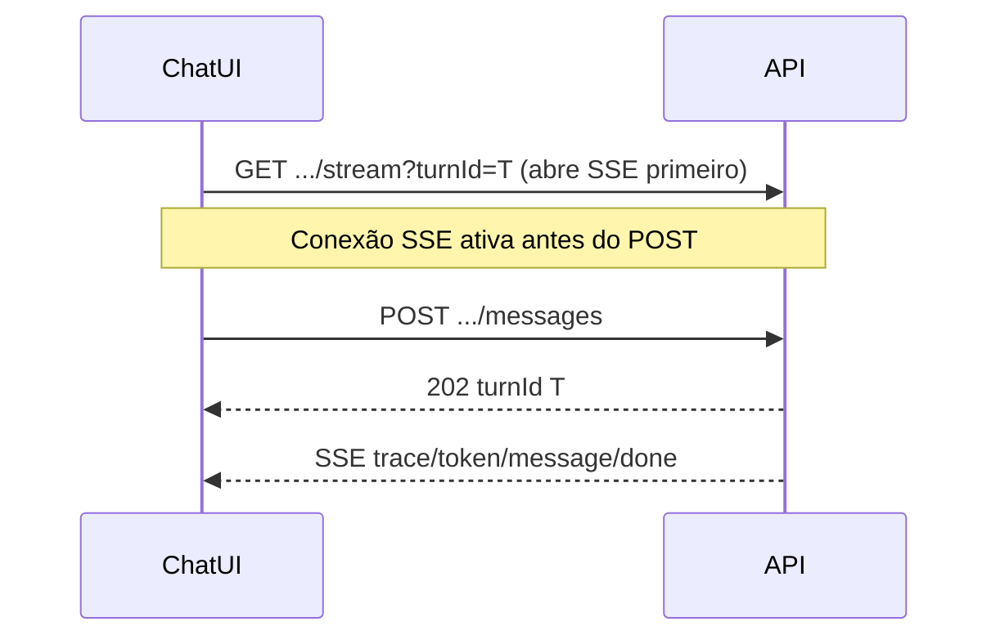
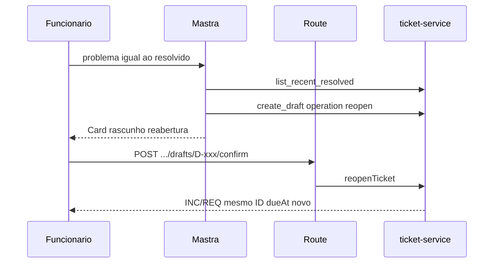

# Contratos de API

Convenções: JSON `application/json`; erros `{ error: string, code?: string }`; autenticação via cookie de sessão.

## Tempo real — decisão arquitetural

| Canal | Mecanismo | Justificativa |
|-------|-----------|---------------|
| Chat funcionário (resposta agent) | **SSE** | Stream token/chunk; um fluxo por mensagem |
| Console analista (fila e thread) | **HTTP polling** | Sem WebSocket; proxies e restart friendly; VPS enxuta |

### Variáveis de polling (analista)

Valores canônicos: [02-09-variaveis-ambiente.md](02-09-variaveis-ambiente.md) (`ANALYST_*_MS`).

**Trade-off consciente:** latência máxima ~3s na fila vs. simplicidade operacional; ações críticas usam **fetch imediato** pós-POST (abaixo).

## Autenticação

### `POST /api/auth/login`

```json
{ "email": "ana.souza@nexo.com.br", "password": "any" }
```

**200:** `{ "user": { "id", "email", "name", "role" } }` + Set-Cookie.

**401:** e-mail não seedado.

### `POST /api/auth/logout`

**204.**

## Funcionário — conversas

### `GET /api/conversations/active`

**200:** conversa ativa + `messageCount` (somente mensagens do funcionário), `messageLimit: 30`, `state`.

### `GET /api/conversations/sessions`

Histórico de sessões **encerradas** do funcionário autenticado (`state: closed`).

**200:**

```json
{
  "items": [{
    "conversationId": "uuid",
    "sessionSequence": 1,
    "state": "closed",
    "updatedAt": "ISO-8601",
    "preview": "última mensagem ou rótulo da sessão"
  }]
}
```

Somente leitura na UI; não altera a conversa ativa.

### `POST /api/conversations/active/messages`

Body: `{ "content": string, "turnId"?: string }` — se omitido, o servidor gera `turnId` no 202; se enviado (UUID cliente), deve ser o mesmo usado no SSE aberto antes do POST.

1. Persiste `Message` do usuário; incrementa `messageCount` (não conta resposta do assistente).
2. Enfileira turno do agent (não bloqueia até o fim do LLM).
3. **202** `{ "conversationId", "userMessageId", "turnId" }` — `turnId` correlaciona SSE e persistência da resposta.

### `GET /api/conversations/:id/stream`

Query obrigatória no turno ativo: `turnId` (emitido no 202). Opcional: `Last-Event-ID` para retomada.

**Ordem recomendada no cliente (evita race):**



1. Cliente gera `turnId` (UUID) **localmente** e abre SSE com esse `turnId` **antes** do POST (padrão preferido), **ou**
2. Cliente faz POST primeiro e abre SSE **imediatamente** com o `turnId` do 202 (aceitável se &lt; ~100ms).

**Fallback sem SSE / conexão perdida:**

- Se SSE falhar antes de `done`: UI mostra “Reconectando…”; `GET .../stream?turnId=` com `Last-Event-ID` ou após timeout **`GET /api/conversations/active`** + **`GET .../messages?since=`** para buscar mensagem assistant persistida.
- Servidor **sempre** persiste mensagem final e `AgentTrace` no `done`, mesmo se nenhum cliente estiver conectado ao SSE.
- Evento `error` no SSE não substitui polling de recuperação; cliente deve consultar estado da conversa.

**SSE eventos:**

| event | payload |
|-------|---------|
| `trace` | `AgentTrace` parcial |
| `token` | `{ "delta": string }` |
| `message` | `Message` completa + `uiBlocks` |
| `done` | `{ "messageId" }` |
| `error` | `{ "code", "message" }` |

Headers: `Content-Type: text/event-stream`, `Cache-Control: no-cache`.

### `POST /api/conversations/active/new-session`

Arquiva sessão; zera contador; **200** nova conversa.

## Ticket service (HTTP) — funcionário

Todas exigem sessão; `requesterId` = usuário logado. **Toda mutação** delega a `lib/ticket-service` (nunca Prisma direto na rota). Analista usa rotas analista com `employeeId` explícito.

### Leitura

#### `GET /api/tickets`

Query opcional: `scope=open` (default) | `recent_resolved` + `withinDays=7`.

**200:** `{ "items": TicketSummary[] }`.

#### `GET /api/tickets/:id`

**403** se não dono. **200:** `TicketDetail`.

### Mutações via rascunho (caminho canônico — F4)

O *agent* cria rascunhos **somente via tools** (`create_draft`), persistidos pelo ticket-service. O card no chat referencia `draftId` (ex.: `D-381`). O campo `operation` no payload do draft define o efeito ao confirmar:

| `operation` | Chamada ticket-service | Resultado |
|-------------|------------------------|-----------|
| `create` | `confirmDraft` | Novo INC/REQ |
| `update` | `updateTicket` (patch no draft) | Mesmo ID atualizado |
| `reopen` | `reopenTicket` | Mesmo ID reaberto; `dueAt` recalculado |

Regras: [02-08 — duplicidade e reabertura](02-08-regras-service-desk.md#duplicidade-e-reabertura).

#### `PATCH /api/tickets/drafts/:draftId`

Disparado por **Editar → Salvar** no card (G2-UI-02). Body: subconjunto não vazio de `type`, `category`, `title`, `description`, `priority`, `affectedScope` (campos desconhecidos são rejeitados). A prioridade editada vale como está e `dueAtPreview` é recalculado.

**200:** `DraftSummary` (`draftId`, `operation`, `title`, `priority`, `dueAtPreview`, `affectedScope`, `type`, `category`, `description`).  
**400:** corpo inválido (`fields` lista os campos), rascunho já finalizado ou expirado.  
**401:** não é funcionário.  
**403:** não dono.  
**404:** rascunho inexistente.  
**503:** legado.

O bloco de UI `draft_card` ganhou, de forma **aditiva**, `ticketType`, `category` e `description`.

#### `POST /api/tickets/drafts/:draftId/confirm`

Disparado pelo botão **Confirmar** no card ou quick action equivalente.

Body opcional: `{ "conversationId": "uuid" }` (para mensagem de sistema no chat).

**200:** `TicketDetail`.  
**400:** draft expirado ou `operation` inválida.  
**403:** não dono.  
**503:** legado — corpo padrão chaos.

#### `POST /api/tickets/drafts/:draftId/cancel`

Disparado por **Cancelar** no card.

**204.** Draft marcado cancelado; nenhuma mutação no ITSM simulado.

#### Alias legado (evitar na implementação nova)

`POST /api/conversations/drafts/:draftId/confirm|cancel` — se existir, deve **delegar** às rotas `/api/tickets/drafts/...` acima (um único handler interno).

### Reabertura sem segunda rota dedicada

**Não** expor `POST /api/tickets/:id/reopen` direto ao browser na F4. Reabertura ocorre **sempre** como `operation: "reopen"` em rascunho confirmado pelo usuário (após o agent propor com `reopen_ticket` / `list_recent_resolved`). Isso mantém a regra do Anexo A: **nenhuma mutação sem confirmação explícita**.

Fluxo resumido:



### Server-only (tools / evolução HTTP)

`POST /api/internal/tickets/drafts` — criação de draft pelo agent in-process (F4); não obrigatório expor se tools chamarem o client direto no monólito.

### Resposta 503 (chaos)

```json
{ "error": "Sistema de chamados temporariamente indisponível", "code": "TICKET_LEGACY_UNAVAILABLE", "retryAfterMs": 3000 }
```

Client deve retry backoff: 1s, 2s, 4s (máx 3). No agent o retry é feito pelo adapter (`createResilientTicketClient`, configurável por `TICKET_RETRY_*`); a API HTTP responde 503 imediato.

### Erros de validação de rascunho (aditivo)

Rascunho com campos obrigatórios ausentes ou inválidos (6 campos: tipo, categoria, título, descrição, prioridade, abrangência) responde **400** `{ "error": string, "fields": string[] }`. Estado inválido (ex.: transferir chamado resolvido, rascunho expirado) também responde 400.

## Analista — inbox e thread

### `GET /api/analyst/inbox`

Query: `updatedSince` ISO timestamp opcional.

**200:**

```json
{
  "items": [{
    "conversationId": "uuid",
    "employeeName": "Ana Souza",
    "employeeDepartment": "Financeiro",
    "linkedTicketId": "INC-20311",
    "preview": "…",
    "state": "awaiting_analyst",
    "unreadCount": 2,
    "confidenceLast": 41,
    "updatedAt": "…",
    "needsReview": true,
    "inboxKind": "handoff"
  }],
  "serverTime": "…"
}
```

`inboxKind` é `handoff` (transferida/assumida) ou `review` (ainda com o agent, última confiança abaixo de `AGENT_CONFIDENCE_TRANSFER_OFFER` ou regra `TRANSFER_LOW_CONFIDENCE`); `needsReview` indica baixa segurança do último turno (aditivos, G2-AN-01).

**Headers:** `ETag: "hash-inbox"` — cliente envia `If-None-Match` → **304** sem body.

### `GET /api/analyst/conversations/:id/messages`

Query: `since` message id ou timestamp.

**200:** `{ "messages": Message[], "state", "assignedAnalyst", "employeeId", "handoffSummary" }`.

`handoffSummary` (aditivo, `null` sem transferência) é o snapshot da última transferência:

```json
{
  "problem": "E-mail corporativo fora do ar",
  "stepsTried": ["Rascunho crítico criado"],
  "ticketIds": ["INC-20311"],
  "reason": "Caso crítico (equipe ou empresa parada)",
  "confidence": 78,
  "rulesFired": ["TRANSFER_CRITICAL", "TRANSFER_TO_ANALYST"]
}
```

### `POST /api/analyst/conversations/:id/messages`

Body: `{ "content": string }`. Apenas com conversa em `with_analyst` e analista assignee da sessão.

**201:** `{ "messageId": string }` — mensagem `role=analyst`.

### `POST /api/analyst/conversations/:id/assume`

**200:** `{ "state": "with_analyst", "assignedAnalystId": "…" }`  
**409:** `{ "error": "already_assigned", "assignedAnalyst": { "name": "…" } }`

**Cliente:** fetch imediato inbox + messages (não aguardar poll).

### `POST /api/analyst/conversations/:id/return-to-agent`

**200:** `{ "state": "with_agent" }`; persiste `Message` system “Analista devolveu ao Nexo Assist”.

**Cliente:** fetch imediato; funcionário na próxima interação/SSE vê agent ativo.

### `POST /api/analyst/conversations/:id/close`

**200:** `{ "state": "closed" }`.

### `GET /api/analyst/employees/:id/tickets`

Painel lateral chamados.

**200:**

```json
{
  "items": [ { "id": "INC-20311", "title": "…", "statusLabel": "…" } ],
  "summary": { "open": 2, "closed": 5 }
}
```

`closed` = chamados `resolved` nos últimos **90** dias (`listRecentResolved`).

### `GET /api/analyst/conversations/:id/traces`

Lista `AgentTrace` completo para UI analista. Cada item inclui `trace.durationMs?` (delta entre mensagem `user` anterior e `assistant`, sem campo persistido).

## Payload `AgentTrace`

`confidence` é **inteiro 0–100** (não fração). Ver [Convenção de confidence](02-08-regras-service-desk.md#convenção-de-confidence).

```json
{
  "understanding": "Usuário relata VPN erro 809 no Windows 11",
  "actions": ["list_open_tickets", "search_kb"],
  "confidence": 72,
  "rulesFired": ["SCOPE_IT", "KB_PARTIAL_MATCH"],
  "evidence": [
    { "type": "article", "id": "vpn-erro-809", "excerpt": "…" },
    { "type": "ticket", "id": "INC-20311" }
  ]
}
```

## Knowledge base

### `GET /api/kb/search?q=`

Query FTS; máx 5 resultados. Uso interno/agent; pode expor para debug com flag dev.

## Chaos (dev/test)

### `POST /api/dev/chaos/ticket-outage`

Body: `{ "durationMs": 5000, "enabled": true }`. Requer `CHAOS_ENDPOINT_ENABLED=true` ([02-09](02-09-variaveis-ambiente.md)). Para E2E e entrevista.

## Resiliência a restart

- Polling stateless; `updatedSince` / `since` recuperam mensagens perdidas.
- Nenhuma sticky session obrigatória no load balancer.