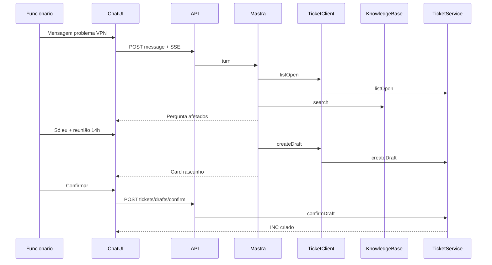
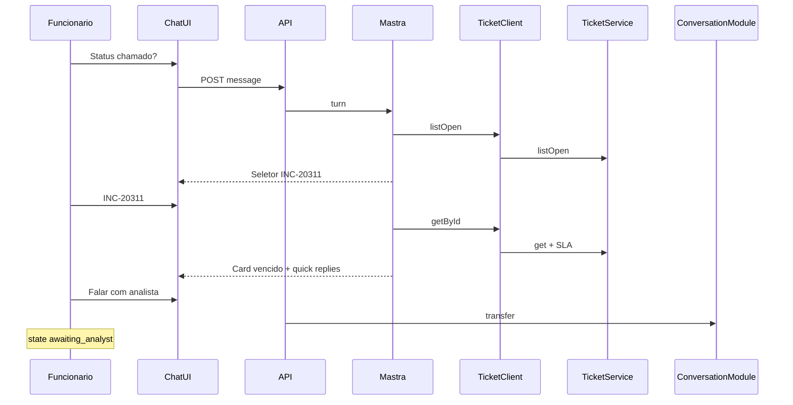
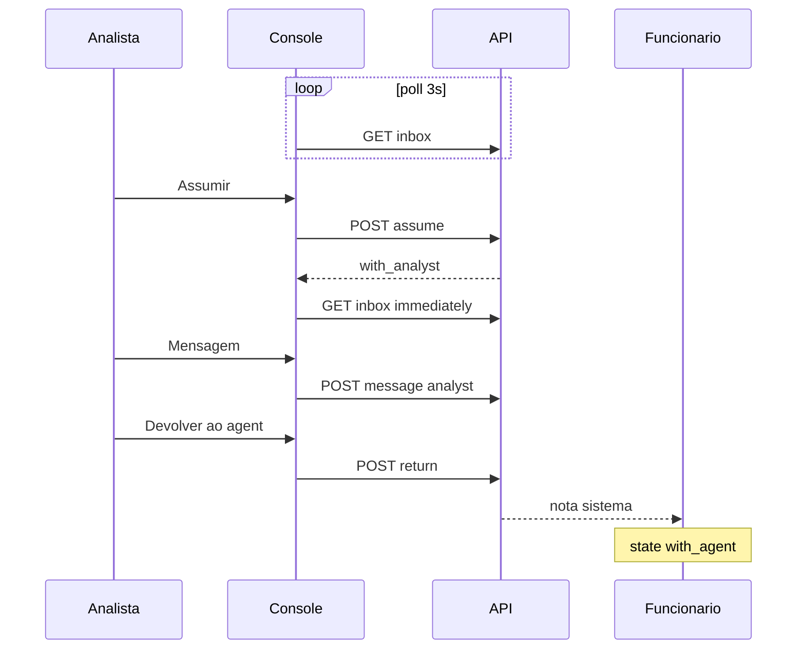
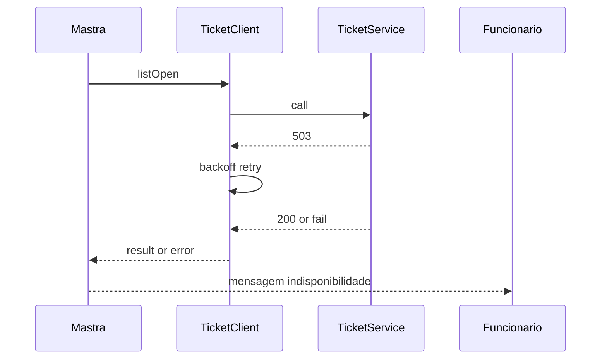

# Fluxos executivos

## FE-01 — Abrir chamado (VPN)

## FE-02 — Consultar vencido e transferir

## FE-03 — Analista assumir e devolver

## FE-04 — Falha legado 503

## FE-05 — Nova sessão 30 mensagens

1. Contador atinge 30 na conversa ativa.  
2. Composer desabilitado; banner explicativo.  
3. Usuário clica **Nova sessão**.  
4. Sistema cria conversa nova `sessionSequence+1`; anterior somente leitura.  

## FE-06 — Deploy CI/CD (F5)

1. Push main → GitHub Actions.  
2. Unit + integration + evals.  
3. Build image Docker.  
4. SSH VPS → pull → compose up → healthcheck.  
5. Rollback: tag imagem anterior documentado no README.