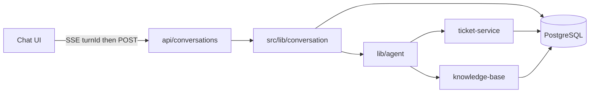

# Arquitetura do código (estado atual)

**Marco:** M3 — Agent leitura + SSE  
**Referência:** [02-03](../02-especificacao/02-03-especificacao-tecnica.md), [02-07](../02-especificacao/02-07-contratos-api.md)

## Visão M3

## Pastas-chave

| Pasta | Responsabilidade |
|-------|------------------|
| `lib/agent/` | Turn runner, tools leitura, fixtures — **sem Prisma** |
| `src/lib/conversation/` | Mensagens, `AgentTrace`, SSE `turn-bus` |
| `src/lib/ticket-service/` | Chamados (M2) |
| `src/lib/knowledge-base/` | FTS KB (M2) |

## Fluxo SSE (02-07)

1. Cliente gera `turnId` e abre `GET /api/conversations/:id/stream?turnId=`.
2. `POST /api/conversations/active/messages` com `{ content, turnId }` → **202**.
3. Eventos: `trace`, `token`, `message`, `done`.
4. Persistência assistant + `AgentTrace` no `done`.

Rotas SSE: `runtime = nodejs`, `dynamic = force-dynamic`.

## Agent / OpenRouter

- Dev/CI: `AGENT_EVAL_FIXTURES=true` (default sem `OPENROUTER_API_KEY`).
- Produção manual: configurar `OPENROUTER_API_KEY` + `OPENROUTER_MODEL`; `LLM_MAX_CONCURRENCY` (default 2).

Orchestrator em `lib/agent` preparado para integração Mastra/OpenRouter; F3 usa fixture determinístico para evals estáveis.

## Contrato de turno (estável na F4)

A F4 deve **estender** o mesmo pipeline, sem quebrar rotas M3:

| Camada | Contrato atual (M3) | Extensão F4 |
|--------|---------------------|-------------|
| `runAgentTurn` | `content` + `trace` + `uiBlocks` | Mesma forma; novos tipos de `UiBlock` (draft) |
| `executeTurn` | SSE + persistência no `done` | Transfer → `conversation.state = awaiting_analyst` na rota, não no agent |
| Tools | 4 leitura | + `create_draft`, `update_ticket`, `reopen_ticket`, `cancel_draft`, `transfer_conversation` |
| `lib/agent` | Adapters injetados, sem Prisma | Mantido |
| `rules.ts` | `SCOPE_IT`, SLA, KB | + `out_of_scope` (RH/facilities) |

Referência evals: **EVAL-06**–**10** em [03-02](../03-processos-validacao/03-02-plano-testes.md); fixtures em `lib/agent/fixture-turn.ts` até OpenRouter estável em CI.

## Playwright (E2E)

- Config: `workers: 1`, `fullyParallel: false` — reduz *cold start* do `next dev`.
- F4: isolar **E2E-CHAOS** (gate M4) para não competir com LOGIN/STATUS/KB na mesma execução paralela.