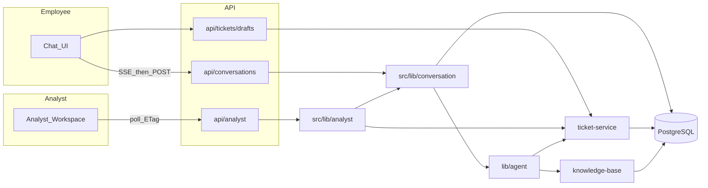

# Arquitetura do código (estado atual)

**Marco:** M5 — Console analista + CI/hardening  
**Referência:** [02-03](../02-especificacao/02-03-especificacao-tecnica.md), [02-07](../02-especificacao/02-07-contratos-api.md)

## Visão M5

## Pastas-chave

| Pasta | Responsabilidade |
|-------|------------------|
| `lib/agent/` | Turn runner, tools leitura + mutação, fixtures — **sem Prisma** |
| `src/lib/conversation/` | Mensagens, transfer, limite 30, SSE `turn-bus` (globalThis) |
| `src/lib/analyst/` | Inbox ETag, handoff assume/return/close, traces |
| `src/lib/ticket-service/` | Chamados + drafts (único writer INC/REQ) |
| `src/lib/domain/` | `dedup`, `rules` (incl. OUT_OF_SCOPE) |
| `src/lib/knowledge-base/` | FTS KB (M2) |
| `src/lib/dev/` | Reset seeds E2E (`analyst-transfer-seeds`) |

## Fluxo SSE (funcionário)

1. Cliente gera `turnId` e abre `GET /api/conversations/:id/stream?turnId=`.
2. Aguarda evento `open` do `EventSource` (`use-chat-stream.ts`).
3. `POST /api/conversations/active/messages` com `{ content, turnId }` → **202** (423 com analista).
4. Eventos: `ready`, `trace`, `token`, `message`, `done`, `agent_error`.
5. Persistência assistant + `AgentTrace` no `done`.

## Polling analista (M5)

- `GET /api/analyst/inbox` — header `ETag`; `If-None-Match` → **304**.
- Thread: `GET .../messages`, `GET .../traces`; painel `GET /api/analyst/employees/:id/tickets`.
- Intervalos: `ANALYST_POLL_*` (server props → client), ver [02-09](../02-especificacao/02-09-variaveis-ambiente.md).

## Auth (iron-session)

- Middleware lê sessão em `nexo_session` (`src/middleware.ts`).
- Rate limit leve em `/api/*` (exc. auth/dev; off com `CHAOS_ENDPOINT_ENABLED`).

## Agent / OpenRouter

- Dev/CI: `AGENT_EVAL_FIXTURES=true` (default sem `OPENROUTER_API_KEY`).
- Produção: `OPENROUTER_API_KEY` + `OPENROUTER_MODEL`; `LLM_MAX_CONCURRENCY` (default 2).
- Orchestrator próprio (não `@mastra/core` pinado) — ver [04-03 §3](../04-registro-mudanca/04-03-as-built.md).

## Gates CI vs local

| Onde | Unit + evals | E2E Playwright | `next build` | Docker image |
|------|----------------|----------------|--------------|--------------|
| **Local (pré-push)** | `npm run test:unit` + `npm run test:evals` | `npm run test:e2e` (`workers: 1`) | `npm run build` | opcional |
| **GitHub Actions** | job `test` | job `e2e` (`needs: test`) | job `test` | job `build` (`needs: e2e`) |

Variáveis espelhadas no job `e2e`: `AGENT_EVAL_FIXTURES=true`, `TICKET_CHAOS_RATE=0`, `CHAOS_ENDPOINT_ENABLED=true`, `DATABASE_URL`, `SESSION_SECRET`.

## Testes (M7)

| Camada | IDs |
|--------|-----|
| Unit/INT | Vitest (SLA, RBAC, boundary, analyst poll/409, …) |
| Evals | **EVAL-01**–**EVAL-15** |
| E2E | `e2e-01` … `e2e-16` (Playwright em **127.0.0.1:3099**) |

## Playwright (E2E)

- `playwright.config.ts`: `workers: 1`, `NEXT_DIST_DIR=.next-playwright` no `webServer`, `CHAOS_ENDPOINT_ENABLED=true`.
- Dev manual (`npm run dev`) usa `.next` na porta 3000 — não executar E2E e dev em paralelo.
- `resetAnalystTransferSeeds` + `/api/dev/reset-analyst-seeds` antes dos specs analista.

Lacunas vs protótipo: [GAPS.md](../desafio/GAPS.md).