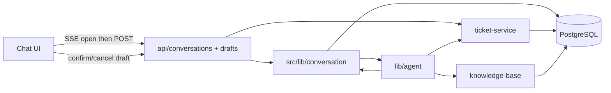

# Arquitetura do código (estado atual)

**Marco:** M4 — Mutações via draft + transfer  
**Referência:** [02-03](../02-especificacao/02-03-especificacao-tecnica.md), [02-07](../02-especificacao/02-07-contratos-api.md)

## Visão M4

## Pastas-chave

| Pasta | Responsabilidade |
|-------|------------------|
| `lib/agent/` | Turn runner, tools leitura + mutação, fixtures — **sem Prisma** |
| `src/lib/conversation/` | Mensagens, transfer, limite 30, SSE `turn-bus` (globalThis) |
| `src/lib/ticket-service/` | Chamados + drafts (único writer INC/REQ) |
| `src/lib/domain/` | `dedup`, `rules` (incl. OUT_OF_SCOPE) |
| `src/lib/knowledge-base/` | FTS KB (M2) |

## Fluxo SSE (02-07)

1. Cliente gera `turnId` e abre `GET /api/conversations/:id/stream?turnId=`.
2. Aguarda evento `open` do `EventSource` (`use-chat-stream.ts`).
3. `POST /api/conversations/active/messages` com `{ content, turnId }` → **202**.
4. Eventos: `ready`, `trace`, `token`, `message`, `done`, `agent_error`.
5. Persistência assistant + `AgentTrace` no `done`.

Rotas SSE: `runtime = nodejs`, `dynamic = force-dynamic`.

## Auth (iron-session)

- Middleware lê sessão em `nexo_session` (`src/middleware.ts`).
- `POST /api/auth/login` monta `NextResponse.json` e chama `getIronSessionFromRequest(request, response)` para que o `Set-Cookie` acompanhe a mesma resposta HTTP.

## Agent / OpenRouter

- Dev/CI: `AGENT_EVAL_FIXTURES=true` (default sem `OPENROUTER_API_KEY`).
- Produção manual: configurar `OPENROUTER_API_KEY` + `OPENROUTER_MODEL`; `LLM_MAX_CONCURRENCY` (default 2).

Orchestrator em `lib/agent` preparado para integração Mastra/OpenRouter; F3 usa fixture determinístico para evals estáveis.

## Contrato de turno (M4)

| Camada | Comportamento |
|--------|----------------|
| `runAgentTurn` | `content` + `trace` + `uiBlocks` (`draft_card`, `ticket_card`, …) |
| `executeTurn` | SSE + persistência no `done` |
| Transfer | Tool `transfer_to_analyst` → adapter Prisma em `src/lib/conversation` |
| Tools | Leitura + `create_draft`, `update_ticket`, `reopen_ticket`, `cancel_draft`, `transfer_to_analyst` |
| Dedup | `resolveDraftOperation` antes de draft (fixture EVAL-07/08) |

Evals: **EVAL-01**–**10**; E2E `e2e-01` … `e2e-07`.

## Playwright (E2E)

- `playwright.config.ts`: `workers: 1`, `fullyParallel: false`, `baseURL` default `http://127.0.0.1:3099`.
- `webServer`: `npx next dev -H 127.0.0.1 -p 3099`; carrega `.env`; força `AGENT_EVAL_FIXTURES=true` no processo de teste.
- `reuseExistingServer` apenas com `PLAYWRIGHT_REUSE_SERVER=1` (opcional; alinhar `PLAYWRIGHT_BASE_URL`).
- `e2e/auth.ts`: `loginAsAna` via `page.request.post('/api/auth/login')` + `goto('/atendimento')`.
- **E2E-CHAOS:** mock `page.route` na rota confirm (503); `TICKET_CHAOS_RATE=0` no harness padrão.