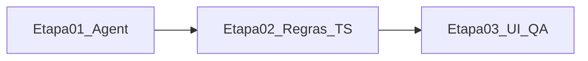

# Planos de execução — gaps-v2 (comportamento PRD)

**Data:** 2026-11-24  
**App de entrada:** `0.7.1-m7.1` (+ trabalho local não commitado: `lib/agent/llm-turn.ts`, `lib/agent/openrouter.ts`)  
**Pacote docs alvo (pós-código):** `0.3.4`  
**App alvo (pós-código):** `0.8.0-m8` (sugerido)

Guias para fechar lacunas catalogadas em [GAPS2.md](../../desafio/GAPS2.md) — **comportamento real do agent e regras Anexo A** vs [PRD v5](../../desafio/Desafio_Tecnico_Nexo_Assist_PRD_v5.pdf). Complementam [F1–F5](../README.md) e o fechamento visual/CI de [gaps/](../gaps/README.md) (GAPS.md); **não substituem** [02-02](../../02-especificacao/02-02-especificacao-funcional.md) nem [02-07](../../02-especificacao/02-07-contratos-api.md).

**As built de referência:** [04-03-as-built.md](../../04-registro-mudanca/04-03-as-built.md) — a Etapa 01 **supersede** a linha “orchestrator próprio / Mastra pendente” quando o código for entregue (requisito PRD `G2-AG-03`).

---

## Ordem de execução (obrigatória)

| Ordem | Guia | Quando |
|-------|------|--------|
| 1 | [etapa-01-agent-mastra-contexto-transparencia.md](etapa-01-agent-mastra-contexto-transparencia.md) | Mastra, tool calling, histórico de turno, trace com `reasoning` |
| 2 | [etapa-02-regras-anexo-a-resiliencia-ticket-service.md](etapa-02-regras-anexo-a-resiliencia-ticket-service.md) | Anexo A no domínio/tools, resiliência, ticket-service (complementos, transfer) |
| 3 | [etapa-03-ui-rascunho-console-e-entrega.md](etapa-03-ui-rascunho-console-e-entrega.md) | UI rascunho/console, evals/README/commits, eficiência LLM |

Etapa 2 **depende** dos contratos de agent/trace da Etapa 1. Etapa 3 **depende** de validação de rascunho, transferência e handoff da Etapa 2.



---

## Vigilância na execução (riscos transversais)

Pontos que costumam quebrar regressão entre etapas. Detalhe nas etapas 01–03; usar como checklist antes de merge.

### 1. Streaming Mastra vs contrato SSE (Etapa 01)

O contrato atual em [`types.ts`](../../../src/lib/conversation/types.ts) prevê eventos `token`, `trace`, `message`, `done`, `agent_error`. [`turn-runner.ts`](../../../src/lib/conversation/turn-runner.ts) publica `trace` parcial no `onTrace` e `token` no `onToken`; a UI ([`use-chat-stream.ts`](../../../src/components/chat/use-chat-stream.ts)) e **E2E-TRACE** assumem essa ordem.

**Na integração Mastra:**

- Emitir `trace` **incremental** (ações conforme tools rodam; `reasoning` no fechamento do turno) sem substituir o evento `message` final.
- Não emitir `done` antes de `addAssistantMessage` concluir (persistência).
- Tool calls/results podem ir em `trace.rawToolCalls` / `evidence`; evitar payload gigante no meio do stream de `token`.
- Testar um turno com 2+ tools: chips de ações e painel trace ainda coerentes.

### 2. Rascunho incompleto vs validação estrita (Etapa 02)

Com `createDraft` rejeitando `create` sem os 6 campos e `confirmDraft` sem defaults, o modelo **não** deve chamar `create_draft` até o payload estar completo (coleta via perguntas / `quick_replies` — G2-RG-02).

**Antes de merge Etapa 02:**

- Ajustar **fixtures** e cenários **EVAL-06+** / **E2E-OPEN** para payloads completos (tipo, categoria, prioridade, `affectedScope`, título, descrição).
- Tool `create_draft`: erros `DraftInvalidError` devolvidos ao Mastra como resultado estruturado, não exceção não tratada.
- Fluxo multi-turno (“Só eu” após pergunta de escopo) coberto por eval ou E2E após Etapa 01+02.

### 3. Resiliência vs E2E-CHAOS (Etapa 02)

`createResilientTicketClient` com backoff [1s, 2s, 4s](../../../src/lib/ticket-service/retry.ts) pode somar **~7s** por chamada falha, multiplicado por tools no mesmo turno.

**Mitigações sugeridas no guia de código:**

- Limitar retry a operações de leitura/mutação via adapter do agent; manter 503 imediato na API HTTP se o PRD de demo exigir feedback rápido na UI de confirmar rascunho.
- Com `TICKET_CHAOS_RATE=1` (**E2E-CHAOS**): cap de tentativas ou timeout por turno; mensagem amigável + trace `TICKET_LEGACY_UNAVAILABLE` sem estourar timeout do Playwright.
- Medir duração do turno após implementação; alinhar `block_until` / timeouts do spec chaos se necessário.

---

## Mapa canônico — 25 itens GAPS2

Reconciliar com [GAPS2.md](../../desafio/GAPS2.md) a cada entrega de código.

| ID | Sev | Etapa | Status alvo | Dependências / notas |
|----|-----|-------|-------------|----------------------|
| G2-AG-01 | C | 01 | `resolvido` | Tool calling; fixture só CI |
| G2-AG-02 | C | 01 | `resolvido` | Histórico + estado do turno |
| G2-AG-03 | C | 01 | `resolvido` | `@mastra/core`; CR as-built |
| G2-AG-04 | M | 01 | `resolvido` | `reasoning` + regras reais no trace |
| G2-RG-01 | M | 02 | `resolvido` | `classifyPriority(impact, urgency)` |
| G2-RG-02 | M | 02 | `resolvido` | 6 campos; sem default na confirmação |
| G2-RG-03 | M | 02 | `resolvido` | Dedup em toda `create` |
| G2-RG-04 | M | 02 | `resolvido` | Critical → transferência |
| G2-RG-05 | M | 02 | `resolvido` | Vencido / `AGENT_CONFIDENCE_*` |
| G2-RG-06 | M | 02 | `resolvido` | Resumo handoff estruturado |
| G2-RG-07 | M | 02 | `resolvido` | RH + financeiro + facilities |
| G2-RS-01 | M | 02 | `resolvido` | Retry no adapter; mensagem amigável |
| G2-RS-02 | M | 02 | `resolvido` | RBAC sem vazar ticket de terceiros |
| G2-TS-01 | M | 02 | `resolvido` | `TicketUpdate`; append descrição |
| G2-TS-02 | M | 02 | `resolvido` | `transfer` no ticket-service |
| G2-UI-01 | M | 03 | `resolvido` | `draft_card` completo PT-BR |
| G2-UI-02 | M | 03 | `resolvido` | Edição real do rascunho |
| G2-UI-03 | B | 03 | `resolvido` | Quick reply analista se `slaBreached` → **G2-RG-05** |
| G2-AN-01 | M | 03 | `resolvido` | Fila baixa confiança → **G2-RG-05** |
| G2-AN-02 | B | 03 | `resolvido` | Filtro “Com o agent” / semântica UX |
| G2-QA-01 | M | 03 | `resolvido` | Evals com variações + `test:evals:llm` opcional |
| G2-QA-02 | M | 03 | `resolvido` | README seções PRD |
| G2-QA-03 | M | 03 | `resolvido` | Conventional Commits da Etapa 1 em diante |
| G2-QA-04 | B | 03 | `resolvido` | Tokens/latência no trace + custo no README |
| G2-QA-05 | B | — | `adiado` | Deploy público (diferencial PRD) |

### Contagem por etapa

- **Etapa 01:** G2-AG-01 … G2-AG-04 (4)
- **Etapa 02:** G2-RG-01 … G2-RG-07, G2-RS-01, G2-RS-02, G2-TS-01, G2-TS-02 (11)
- **Etapa 03:** G2-UI-01 … G2-UI-03, G2-AN-01, G2-AN-02, G2-QA-01 … G2-QA-04 (10); G2-QA-05 fora do escopo obrigatório

---

## Gates globais (após implementação de código)

```bash
npx tsc --noEmit
npm run test:unit
npm run test:evals
npm run test:e2e
npm run build
```

| Gate | Referência |
|------|------------|
| Fronteira agent | **INT-BOUNDARY-01** — `lib/agent/**` sem `@/lib/db` / `@prisma/client` |
| Playwright | `workers: 1` em [playwright.config.ts](../../../playwright.config.ts); porta **3099** E2E |
| CI fixtures | `AGENT_EVAL_FIXTURES=true` no GHA |
| Catálogo testes | [03-02-plano-testes.md](../../03-processos-validacao/03-02-plano-testes.md) |

---

## Decisões fixas (não renegociar)

| Tema | Decisão | Gap relacionado |
|------|---------|-----------------|
| Handoff employee | Composer off + `POST` mensagens → **423** em `awaiting_analyst` / `with_analyst` | **G-UI-E08** `aceito` ([gaps-v1](../gaps/README.md)) |
| Console analista | SPA única `/atendente/conversas` | **G-UI-A06** `aceito` |
| Mutação tickets | Só via rascunho confirmado; ticket-service único writer | As-built §2.1 |
| Fixtures CI | Determinísticos; **não** planejador de produção | G2-AG-01, G2-QA-01 |

---

## Relação gaps-v1 vs gaps-v2

| Pacote | Foco | Catálogo |
|--------|------|----------|
| [gaps/](../gaps/README.md) | Fidelidade UI employee/analista, CI, CR handoff | [GAPS.md](../../desafio/GAPS.md) |
| **gaps-v2/** (este) | Qualidade de decisão, Anexo A, transparência PRD | [GAPS2.md](../../desafio/GAPS2.md) |

Marcos M1–M7.1 entregaram infraestrutura; gaps-v2 fecha o **produto avaliável** no processo seletivo.

---

## Arquivos-fonte obrigatórios (revisão antes de codar)

| Área | Caminhos |
|------|----------|
| Agent | [lib/agent/fixture-turn.ts](../../../lib/agent/fixture-turn.ts), [llm-turn.ts](../../../lib/agent/llm-turn.ts), [openrouter.ts](../../../lib/agent/openrouter.ts), [run-turn.ts](../../../lib/agent/run-turn.ts), [tools.ts](../../../lib/agent/tools.ts), [adapters.ts](../../../lib/agent/adapters.ts), [config.ts](../../../lib/agent/config.ts) |
| Conversa | [turn-runner.ts](../../../src/lib/conversation/turn-runner.ts), [agent-adapter.ts](../../../src/lib/conversation/agent-adapter.ts), [adapters-factory.ts](../../../src/lib/conversation/adapters-factory.ts), [repository.ts](../../../src/lib/conversation/repository.ts), [types.ts](../../../src/lib/conversation/types.ts) |
| Domínio | [rules.ts](../../../src/lib/domain/rules.ts), [dedup.ts](../../../src/lib/domain/dedup.ts), [sla.ts](../../../src/lib/domain/sla.ts), [ticket-labels.ts](../../../src/lib/domain/ticket-labels.ts) |
| Tickets | [impl/service.ts](../../../src/lib/ticket-service/impl/service.ts), [client.ts](../../../src/lib/ticket-service/client.ts), [retry.ts](../../../src/lib/ticket-service/retry.ts) |
| Analista | [inbox.ts](../../../src/lib/analyst/inbox.ts), [handoff.ts](../../../src/lib/analyst/handoff.ts) |
| UI | [chat-workspace.tsx](../../../src/components/chat/chat-workspace.tsx), [message-bubble.tsx](../../../src/components/chat/message-bubble.tsx), [analyst-workspace.tsx](../../../src/components/analyst/analyst-workspace.tsx) |
| Dados | [prisma/schema.prisma](../../../prisma/schema.prisma), [seed.ts](../../../prisma/seed.ts) |
| Config | [README.md](../../../README.md), [.env.example](../../../.env.example) |

---

## Referências normativas

| Recurso | Caminho |
|---------|---------|
| PRD v5 | [Desafio_Tecnico_Nexo_Assist_PRD_v5.pdf](../../desafio/Desafio_Tecnico_Nexo_Assist_PRD_v5.pdf) |
| Lacunas comportamentais | [GAPS2.md](../../desafio/GAPS2.md) |
| Protótipo / PNG | [desafio/](../../desafio/README.md), [protótipo-mapeamento.md](../../anexos/protótipo-mapeamento.md) |
| Personas seed | [personas-seed.md](../../anexos/personas-seed.md) |
| API / variáveis | [02-07](../../02-especificacao/02-07-contratos-api.md), [02-09](../../02-especificacao/02-09-variaveis-ambiente.md) |
| As built / CR | [04-03](../../04-registro-mudanca/04-03-as-built.md), [04-02](../../04-registro-mudanca/04-02-registro-mudancas.md) |

Atualizar [GAPS2.md](../../desafio/GAPS2.md) e [04-03-as-built.md](../../04-registro-mudanca/04-03-as-built.md) ao concluir cada etapa de **código** (não apenas estes guias).