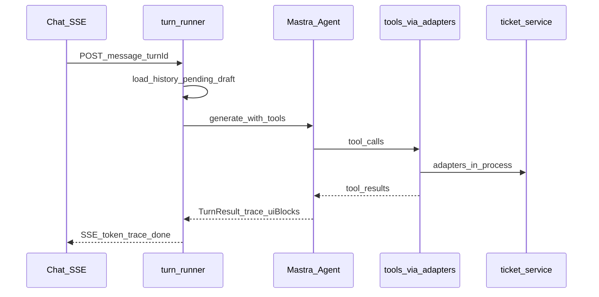

# Etapa 01 — Agent Mastra, contexto de conversa e transparência

**Data:** 2026-11-24  
**App entrada:** `0.7.1-m7.1`  
**App alvo (código):** `0.8.0-m8` (slice parcial; regras Anexo A na Etapa 02)

## 1. Cabeçalho e escopo da etapa

### IDs cobertos ([GAPS2.md](../../desafio/GAPS2.md))

| ID | Sev | Objetivo |
|----|-----|----------|
| G2-AG-01 | C | Decisão por **tool calling** / LLM, sem regex de produção acoplada a seed |
| G2-AG-02 | C | Histórico de mensagens + estado (rascunho pendente, foco) em cada turno |
| G2-AG-03 | C | Runtime **@mastra/core** (requisito PRD); supersede as-built orchestrator-only |
| G2-AG-04 | M | Campo `reasoning` e regras derivadas da **execução**, não do texto do usuário |

### Objetivo da etapa

Substituir o planejamento por regex (`matchPlan`) como caminho de produção por um **Agent Mastra** com ferramentas existentes, contexto conversacional e trace alinhado ao critério PRD *Transparência* (“por quê”).

### Pré-requisitos

- M1–M7.1 concluídos; E2E 01–13 verdes no baseline atual.
- OpenRouter opcional (`OPENROUTER_API_KEY` + `AGENT_EVAL_FIXTURES=false`).
- Resolver ou commitar trabalho local em `lib/agent/llm-turn.ts` e `lib/agent/openrouter.ts` no início desta etapa.

### Fora desta etapa

- Validação dos 6 campos de chamado, dedup generalizada, transferências automáticas → [etapa-02](etapa-02-regras-anexo-a-resiliencia-ticket-service.md).
- Cartão de rascunho completo, inbox analista, evals ampliados → [etapa-03](etapa-03-ui-rascunho-console-e-entrega.md).

### Reconciliação as-built

[04-03-as-built.md](../../04-registro-mudanca/04-03-as-built.md) §2 e tabela de divergências registra “Orchestrator próprio + fixture CI”. Ao entregar esta etapa:

- Atualizar as-built: runtime = Mastra + adapters; fixtures = ramo paralelo CI.
- Registrar CR em [04-02](../../04-registro-mudanca/04-02-registro-mudancas.md) se houver migração `AgentTrace`.

---

## 2. Diagnóstico do estado atual no repositório

| Gap ID | Arquivo(s) | Lacuna real vs PRD |
|--------|------------|---------------------|
| G2-AG-01 | [`lib/agent/fixture-turn.ts`](../../../lib/agent/fixture-turn.ts) `matchPlan` | Dezenas de branches regex; IDs `INC-20311`, `INC-20150`; condição `userName.includes("diego")`. Mensagem livre cai em fallback confiança 55%. |
| G2-AG-01 | [`lib/agent/llm-turn.ts`](../../../lib/agent/llm-turn.ts) | Chama `runFixtureTurn(..., { emitTokens: false })` e só pede ao OpenRouter para redigir texto; **não** escolhe tools. |
| G2-AG-02 | [`src/lib/conversation/turn-runner.ts`](../../../src/lib/conversation/turn-runner.ts) `executeTurn` | `runAgentTurn(params.content, ctx, ...)` — uma única string; sem mensagens anteriores nem rascunho pendente. |
| G2-AG-03 | [`package.json`](../../../package.json) | Ausência de `@mastra/core`; [`lib/agent/run-turn.ts`](../../../lib/agent/run-turn.ts) orquestra fixture/LLM scaffold. |
| G2-AG-04 | [`lib/agent/adapters.ts`](../../../lib/agent/adapters.ts) `TurnResult.trace` | Sem `reasoning`; [`src/lib/domain/rules.ts`](../../../src/lib/domain/rules.ts) `inferRulesFromContent` infere regras por regex no **input** do funcionário. |
| G2-AG-04 | [`prisma/schema.prisma`](../../../prisma/schema.prisma) `AgentTrace` | Colunas: `understanding`, `actions`, `confidence`, `rulesFired`, `evidence`, `rawToolCalls` — sem `reasoning` nem métricas de uso. |
| G2-AG-04 | UI [`message-bubble.tsx`](../../../src/components/chat/message-bubble.tsx) | Trace expandível parcial; não exibe justificativa nem rótulos de regra legíveis (Etapa 03 pode polir UI). |

### Fluxo alvo (referência)



---

## 3. Checklist de implementação (ordem topológica)

### 3.1 Dependências e configuração

| Passo | Ação |
|-------|------|
| 1 | Adicionar `@mastra/core` (e provider OpenAI-compatível apontando para OpenRouter — reutilizar URL/headers de [`openrouter.ts`](../../../lib/agent/openrouter.ts)). |
| 2 | Documentar pin de versão; variáveis existentes em [`.env.example`](../../../.env.example): `OPENROUTER_*`, `LLM_MAX_CONCURRENCY`, `AGENT_EVAL_FIXTURES`. |
| 3 | Nova variável **`AGENT_HISTORY_MAX_MESSAGES`** (default sugerido: 20) e opcional **`AGENT_MAX_OUTPUT_TOKENS`** (prepara G2-QA-04). Espelhar em [02-09](../../02-especificacao/02-09-variaveis-ambiente.md) na entrega de código. |

### 3.2 Contratos TypeScript / Zod

| Passo | Ação |
|-------|------|
| 4 | Estender `TurnResult.trace` em [`adapters.ts`](../../../lib/agent/adapters.ts): `reasoning: string`; `rulesFired` como objetos `{ id: RuleId; label: string }` ou manter string[] + mapa PT em `src/lib/chat/rule-labels.ts` (novo). |
| 5 | Opcional em trace: `usage?: { promptTokens: number; completionTokens: number; latencyMs: number }`. |
| 6 | Criar `lib/agent/schemas.ts` com `AgentTurnSchema` (Zod): `understanding`, `confidence`, `reasoning`, `content` (resposta ao usuário), lista de tool calls permitidas. |
| 7 | Alinhar [`src/lib/conversation/types.ts`](../../../src/lib/conversation/types.ts) `AgentTracePayload` com o mesmo shape para SSE. |

### 3.3 Contexto de turno (G2-AG-02)

| Passo | Ação |
|-------|------|
| 8 | Novo tipo `TurnContext` em `lib/agent/turn-context.ts`: `messages: { role; content }[]`, `pendingDraft?: DraftSummary`, `conversationState`, `focusedTicketId?`. |
| 9 | Em [`repository.ts`](../../../src/lib/conversation/repository.ts): `loadTurnContext(conversationId, userId, { maxMessages })` — últimas N mensagens (roles user/assistant/system relevantes), rascunho `TicketDraft.status=pending` do requester, último ticket em `evidence` do trace anterior (opcional). **Prisma só em `src/lib/conversation`**, não em `lib/agent`. |
| 10 | [`turn-runner.ts`](../../../src/lib/conversation/turn-runner.ts): montar `TurnContext` e passar a `runAgentTurn(userMessage, ctx, adapters, turnContext, callbacks)`. |
| 11 | Instruções de sistema Mastra: Anexo A resumido + “use quick_replies uiBlock quando faltar campo” (coleta detalhada na Etapa 02). |

### 3.4 Mastra Agent e tools (G2-AG-01, G2-AG-03)

| Passo | Ação |
|-------|------|
| 12 | Novo módulo `lib/agent/mastra-agent.ts`: registrar tools espelhando [`ToolName`](../../../lib/agent/tools.ts) e delegando a `runTool`. Schemas de argumentos JSON para o modelo. |
| 13 | `runAgentTurn` ([`run-turn.ts`](../../../lib/agent/run-turn.ts)): se `shouldUseFixtures()` → ramo fixture (3.5); senão → Mastra com streaming de tokens via callbacks existentes. |
| 14 | Remover dependência de produção em `llm-turn.ts` como “scaffold + rewrite”; fundir utilidades de streaming OpenRouter no provider Mastra ou manter `openrouter.ts` como client de baixo nível. |
| 15 | Garantir que **qualquer** assunto de TI plausível possa invocar `search_kb`, `list_open_tickets`, `create_draft`, etc., sem mencionar INC fixo. |

### 3.5 Modo fixture CI (G2-AG-01 aceite)

| Passo | Ação |
|-------|------|
| 16 | Refatorar [`fixture-turn.ts`](../../../lib/agent/fixture-turn.ts): `matchPlan` invocado **somente** quando `AGENT_EVAL_FIXTURES=true`; cenários nomeados mapeados para evals (tabela EVAL-01..15). |
| 17 | Eliminar do fixture: `userName.includes("diego")`, IDs hardcoded exceto quando o **eval** injeta contexto explícito. |
| 18 | Manter determinismo para GHA; não usar fixture como fallback silencioso quando OpenRouter falha em demo (preferir erro tratado ou mensagem clara — alinhar com Etapa 02 RS-01). |

### 3.6 Persistência e SSE (G2-AG-04)

| Passo | Ação |
|-------|------|
| 19 | Migração Prisma: `AgentTrace.reasoning` (Text), `AgentTrace.usage` (Json, opcional). |
| 20 | [`repository.ts`](../../../src/lib/conversation/repository.ts) `addAssistantMessage`: persistir novos campos. |
| 21 | Emissor de `rulesFired`: substituir `inferRulesFromContent` no caminho Mastra por função `collectRulesFromToolResults(toolResults, validations)` — implementação completa de validações na Etapa 02; Etapa 01 define hook e contrato. |
| 22 | Streaming: [`sse.ts`](../../../src/lib/conversation/sse.ts) / `publishTurnEvent` inclui `reasoning` nos eventos `trace` parciais e finais. |

### 3.7 Testes (Etapa 01)

| Passo | Ação |
|-------|------|
| 23 | Unit: montagem de `TurnContext` (mensagens truncadas em N). |
| 24 | Unit: parse `AgentTurnSchema` com casos válidos/inválidos. |
| 25 | Manter **INT-BOUNDARY-01**: teste existente em [`tests/int/boundary-agent.test.ts`](../../../tests/int/boundary-agent.test.ts) verde. |
| 26 | Evals podem precisar ajuste na Etapa 03; após Etapa 01, meta mínima: não quebrar `npm run test:evals` com fixtures ou marcar itens a migrar no GAPS2. |

---

## 4. Restrições arquiteturais e regressão

- **`lib/agent/**`:** proibido `@/lib/db` e `@prisma/client` — gate **INT-BOUNDARY-01**.
- **Adapters:** única porta para tickets/KB/handoff — [`adapters-factory.ts`](../../../src/lib/conversation/adapters-factory.ts).
- **HTTP employee:** não alterar sem necessidade **423** / **429** / **202** em [`active/messages/route.ts`](../../../src/app/api/conversations/active/messages/route.ts).
- **Handoff UX:** manter **G-UI-E08** (composer desabilitado; não reverter em favor de “editar via chat” durante analista).
- **Playwright:** `workers: 1`; porta **3099**.
- **Commits:** a partir desta etapa, **Conventional Commits** por mudança coerente (G2-QA-03).

---

## 5. Definition of Done

### Comandos

```bash
npx tsc --noEmit
npm run test:unit
npm run test:evals
npm run build
```

E2E 01–13: regressão obrigatória antes de fechar **gap-v2** por completo (gate forte na Etapa 03); após Etapa 01, rodar `npm run test:e2e` e registrar falhas esperadas até Etapas 02–03.

### Verificação manual por gap

| ID | Roteiro |
|----|---------|
| G2-AG-01 | Com `AGENT_EVAL_FIXTURES=false` e OpenRouter: “o mouse do meu notebook parou de funcionar” → tool coerente (ex. `create_draft` ou KB), não fallback 55%. |
| G2-AG-02 | Após agent perguntar escopo, responder quick reply “Só eu” → rascunho/contexto atualizado na resposta seguinte. Reabrir sessão → agent referencia assunto anterior no histórico carregado. |
| G2-AG-03 | `package.json` lista `@mastra/core`; README (Etapa 03) explica escolha Mastra vs orquestrador anterior. |
| G2-AG-04 | Expandir trace: ver **reasoning** em PT; regras não dependem só de palavra “INC-20311” no texto do usuário. |

### Documentação

- [GAPS2.md](../../desafio/GAPS2.md): G2-AG-01 … G2-AG-04 → `resolvido`.
- [04-03-as-built.md](../../04-registro-mudanca/04-03-as-built.md): runtime agent + Mastra; remover nota “pendente”.
- [04-02-registro-mudancas.md](../../04-registro-mudanca/04-02-registro-mudancas.md): patch docs `0.3.4` se migração trace + 02-09 novas vars.
- [CHANGELOG.md](../../../CHANGELOG.md): versão `0.8.0-m8` (ou incremento parcial documentado).